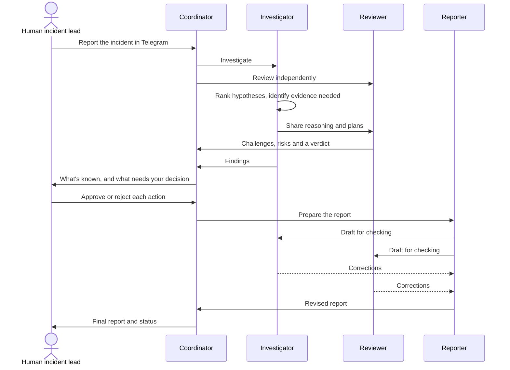

<div align="center">

# SwitchOps

### The AI incident response team that argues with itself, then asks a human.

[](https://github.com/sandbox-quantum/switch)
[](https://claude.com/claude-code)
[](https://telegram.org)
[](LICENSE)
[](#the-test-a-payment-outage-with-no-easy-answer)

**[▶ Watch the demo](https://github.com/vaishalisen2002/switchops/releases/download/v1.0-demo/SwitchOps.mp4)** · **[📖 Read the story on Medium](https://medium.com/@senvaishali91/the-most-dangerous-thing-in-an-outage-is-a-convincing-wrong-answer-so-i-built-an-ai-team-on-switch-5a4be1ea52b4)** · [See it work](#the-test-a-payment-outage-with-no-easy-answer) · [Set it up](#setup-guide)

</div>

---

Payments are failing. A deployment went out twenty minutes ago. Within seconds, everyone has the same story: *the deploy broke it, roll it back.*

The story is tidy, and it might be wrong. The bank could be down. The rollback could collide with a schema change. Retrying those stuck payments could charge customers twice.

Ask a single AI assistant what went wrong and you'll get a fluent, confident answer, whether or not the evidence supports it. Nobody in that chat is there to disagree.

**SwitchOps puts someone in the room whose job is to disagree.** Four specialized AI agents work an incident together in one shared chat, keeping facts apart from guesses and challenging each other in the open. Nothing consequential happens until a human says so.

> [!NOTE]
> SwitchOps is a demonstration. Its test incident is simulated, and no production systems were accessed or changed.

## What makes it different

- **🔍 Guesses stay labelled as guesses.** Agents separate confirmed facts, hypotheses and recommendations.
- **⚔️ Every diagnosis gets challenged.** An independent Reviewer can accept a proposal, accept it with conditions, or reject it.
- **✋ Recommending never counts as approving.** A rollback plan can be ready to go and still not be authorized.
- **📂 A finished report doesn't close an incident.** It stays open until recovery and root cause are supported by evidence.

## Who it's for

- **On-call engineers and SREs** who want a second opinion at 3 a.m.
- **Incident commanders** who need to see what's known, what's assumed and what's waiting on them.
- **Small teams** without enough people to fill every incident role.
- **Teams in high-stakes domains** like payments, where a hasty fix can do more damage than the outage.

## Meet the team

| Agent | Its job | The rule it lives by |
|---|---|---|
| 🧭 `switchops-coordinator` | Leads triage, delegates work, consolidates findings, tracks decisions and maintains incident status | Keep the incident open until the evidence says otherwise |
| 🔬 `switchops-investigator` | Ranks technical hypotheses, identifies the evidence needed and proposes safe investigation or remediation plans | A hypothesis is not a root cause |
| ⚖️ `switchops-reviewer` | Challenges assumptions, checks risks, finds missing evidence and reviews proposed actions | Never agree by default |
| 📝 `switchops-reporter` | Produces the executive summary, timeline, findings, decisions, risks and follow-up actions | Record what was decided, and what wasn't approved |

And one more member, who outranks them all: **you, the human incident lead.**

## How it works


Here's one incident from start to finish:



## The test: a payment outage with no easy answer

I gave the team a simulated UPI payment gateway incident, **INC-DEMO-001**, with a deliberately thin brief: payments failing or stuck in pending, a deployment about 20 minutes ago, and no logs, metrics, deployment diff or provider status.

The timing points straight at the deployment, and nothing proves it. Here's how the team handled that trap.

**The Coordinator refused to treat the theory as fact:**

> **Assumption (not evidence):** the deploy caused it. The timing points that way, but it doesn't prove it.

**The Investigator ranked four hypotheses:** a deployment regression, a callback or webhook failure, connection-pool or infrastructure exhaustion, and an upstream PSP or bank issue. It also prepared a rollback-readiness plan.

**The Reviewer pushed back,** returning **ACCEPT WITH CONDITIONS**. Among its challenges:

- Deployment timing alone doesn't prove causation.
- Raising timeouts without understanding the exhaustion could make things worse.
- Callback signature verification must never be disabled as a shortcut.
- Payment retries must account for idempotency, or customers could be charged twice.

**The human drew the line.** Preparing a hypothetical rollback plan and a deployment-freeze recommendation was approved. Executing the rollback, changing configuration, retrying payments, replaying the DLQ, issuing refunds and contacting customers all stayed unapproved.

**And the team stayed honest about the ending:**

> **Resolved:** NO. There is no recovery evidence and no fix has been run.<br>
> **Root cause confirmed:** NO.<br>
> **Status:** OPEN

A lot of AI demos end with a confident answer. This one ends by saying what it doesn't know yet.

<table>
<tr>
<td></td>
<td></td>
</tr>
</table>

## Why Switch

[Switch](https://github.com/sandbox-quantum/switch) brings AI agents into the chat apps people already use, as named participants in a shared room. It's what turns four agents into one team:

| SwitchOps needs | Switch provides |
|---|---|
| One source of truth for the incident | Rooms that hold context, members and rules |
| Specialized agents | Named agents, each with its own role and working directory |
| A place for the human commander | A Telegram connection, so nobody learns a new tool mid-outage |
| Visible handoffs and disagreement | Mentions and a shared conversation |
| Limits on who can direct an agent | Owner-controlled access to each agent |
| A repeatable setup | YAML room and agent templates |

## The guardrails

These rules are written into the room and agent instructions:

- Separate confirmed facts from hypotheses and recommendations.
- Never fabricate logs, metrics, timestamps or evidence.
- Never claim a root cause is confirmed without supporting evidence.
- Require explicit human approval before consequential production actions.
- Treat approval to prepare a plan as separate from approval to execute it.
- Record approved, rejected and pending decisions separately.
- Treat rollbacks, retries, DLQ replay, refunds, configuration changes and customer communications as actions that may need separate approval.
- Label simulations clearly, and never describe simulated actions as completed production changes.

> [!IMPORTANT]
> These are workflow guardrails in agent instructions. They don't replace production access controls, monitoring or operational policy.

## Setup guide

This takes you from nothing to a running SwitchOps room on your own computer. SwitchOps has no code to install or build: it's a configuration of [Switch](https://github.com/sandbox-quantum/switch), Claude Code and Telegram.

### What you need

- A Mac, Windows or Linux computer
- A [Claude Code](https://claude.com/claude-code) account (Switch uses your own credentials)
- A Telegram account **with a username**, because Switch identifies you by your `@username`

### 1. Install Switch Console

Download the desktop app for your system from the [Switch releases page](https://github.com/sandbox-quantum/switch/releases) and open it. Its **Setting up Switch** checklist tracks your progress, and its assistant, switch-buddy, can answer questions along the way.

### 2. Add a server

From the checklist, select **Add a server**, then **Run a server on this computer**. Switch Console sets everything up, and you don't need Docker. It won't restart on its own after you reboot your computer.

### 3. Check Claude Code

Go to **Settings → Agent providers** and confirm Claude Code says **Installed**. If it doesn't, install it from there.

### 4. Create the four agents

Go to **Your Agents** and create one agent for each row below. The names must match exactly, because the room rules and instructions refer to them.

| Name | Description | Instructions |
|---|---|---|
| `switchops-coordinator` | Orchestrates incident response, tracks approvals and maintains status | Copy the `instructions` block from the [Coordinator template](templates/switchops-coordinator.v2.template.yaml) |
| `switchops-investigator` | Ranks hypotheses and identifies the evidence needed | Use the starter below |
| `switchops-reviewer` | Independently challenges findings and evaluates risks | Use the starter below |
| `switchops-reporter` | Produces the structured incident report | Use the starter below |

For each agent:

- **Run location:** local
- **Agent provider:** Claude Code
- **Working directory:** a separate folder for each agent, containing nothing sensitive, because the agent can read what's there
- **Who can talk to your agent:** **Only me and my agents**. On the default setting, delegation between your agents fails.

<details>
<summary><b>Starter instructions for the Investigator, Reviewer and Reporter</b></summary>

These are starting points based on each agent's role. Adjust them to suit your team.

**switchops-investigator**

```text
You are the Incident Investigator for SwitchOps, a human-led AI incident-response workflow.

Analyze the evidence supplied. Develop and rank root-cause hypotheses. For each one, state the evidence that would confirm or rule it out. Recommend safe diagnostic steps, and prepare remediation or rollback plans for review.

Clearly separate confirmed facts, hypotheses and recommendations. Timing correlation is not proof of root cause. Never fabricate logs, metrics, timestamps or results. Never execute changes or claim a root cause is confirmed without evidence. Label simulations clearly. Post your findings in the room for switchops-coordinator and switchops-reviewer.
```

**switchops-reviewer**

```text
You are the Independent Reviewer for SwitchOps, a human-led AI incident-response workflow.

Do not agree by default. Examine the assumptions behind each diagnosis and plan, identify missing evidence, challenge unsafe recommendations, and evaluate operational and customer risks, including idempotency, reconciliation and refunds where relevant.

Finish each review with a verdict of ACCEPT, ACCEPT WITH CONDITIONS or REJECT, and give your reasons. Accepting a plan does not confirm a diagnosis or authorize execution. Never fabricate evidence. Preserve disagreements and escalate them to the human administrator. Post your review in the room for switchops-coordinator.
```

**switchops-reporter**

```text
You are the Incident Reporter for SwitchOps, a human-led AI incident-response workflow.

When switchops-coordinator asks, produce a structured incident report with an executive summary, timeline, impact, confirmed facts, hypotheses, findings, decisions, risks and follow-up actions, using only what was shared in the room.

List approved, unapproved and pending actions separately. Keep disagreements and unknowns visible. Never add facts, describe simulated actions as completed production changes, or mark an incident resolved without verification. Ask switchops-investigator and switchops-reviewer to check your draft, include their corrections, and send the revised report to switchops-coordinator.
```

</details>

### 5. Connect Telegram

Do these in order, because Telegram only applies the privacy setting when the bot joins a chat.

1. Message [@BotFather](https://t.me/BotFather), send `/newbot`, and save the token somewhere private.
2. Send `/mybots`, choose your bot, then **Bot Settings → Group Privacy → Turn off**.
3. In Switch Console, open your server's **Home** page, then **Messaging apps → Connect → Telegram**. Paste the bot token and username.

Never commit your token or share it in a chat. If it's exposed, send `/revoke` to BotFather.

### 6. Create the room

1. In Telegram, create a private group called **SwitchOps Command Center**. Telegram bots can't create chats, so you have to make it yourself.
2. Add your bot to the group. The room then appears under **Your Rooms** in Switch Console.
3. Send any message in the group.
4. On the server's **Home** page, find the Telegram connection, select **Link my account…**, search for yourself and select **This is me**.

Step 4 only works after you've posted. Without it, agents set to answer their owner will treat you as a stranger.

### 7. Brief the room and invite the team

Open the room in Switch Console and paste the `instructions` block from the [room template](templates/switchops-room.template.yaml) into its **Instructions**.

Then invite each agent by sending these in the group:

```text
!invite-agent @switchops-coordinator
!invite-agent @switchops-investigator
!invite-agent @switchops-reviewer
!invite-agent @switchops-reporter
```

### 8. Run a test incident

First, check that the team is there:

```text
@switchops-coordinator Introduce the incident response team. List every agent in this room with its exact name and responsibility. Do not start an incident yet.
```

Then give it the same simulated incident used in the demo:

```text
@switchops-coordinator Let's start a new simulated incident for a demonstration.

Incident ID: INC-DEMO-001
Service: UPI Payment Gateway
Incident: Customers report that payments are failing or stuck in pending.

The issue reportedly started around 15 minutes ago. A payment-service deployment reportedly happened around 20 minutes ago. We do not yet have logs, metrics, deployment differences or PSP status information.

Register the incident and assign a provisional severity. Separate confirmed information from assumptions. Delegate technical investigation to switchops-investigator and request an independent assessment from switchops-reviewer. Track both agents' findings in this room.

Do not access or modify production systems. Do not invent logs, metrics or investigation results. Do not execute any remediation.
```

**It's working if:**

- The Coordinator labels the deployment theory as an assumption, not a fact.
- The Investigator and Reviewer both respond in the group.
- The Reviewer gives a verdict with its reasons.
- No action is treated as approved until you approve it.
- The incident stays open, because recovery hasn't been verified.

### If something goes wrong

| What you see | What to check |
|---|---|
| Agents don't see messages in the group | Group Privacy may have been on when the bot joined. Turn it off, remove the bot, then add it back. |
| An agent says it can't tell if you're its owner | Link your Telegram account (step 6). |
| You can't find yourself under **Link my account…** | Post in the group first, and make sure your Telegram account has a username. |
| The Coordinator can't get another agent to respond | Set that agent to **Only me and my agents**, and check it has been invited to the room. |
| An agent stays silent | Mention its exact name, such as `@switchops-reviewer`. |

For more detail, see Switch's guides on [getting started](https://github.com/sandbox-quantum/switch/tree/main/docs/official/getting-started) and [connecting Telegram](https://github.com/sandbox-quantum/switch/blob/main/docs/official/deploy/messaging-apps/telegram.md). Setup screens may vary by Switch version.

> [!TIP]
> **Using Slack, Discord, Teams or Mattermost instead?** Choose that app in steps 5 to 7. You can also try creating the room from the [room template](templates/switchops-room.template.yaml) on Switch Console's **Templates** page once your agents exist. The [exported Command Center configuration](templates/switchops-command-center.yaml) shows the original setup for reference.

## Contributing

Ideas and improvements are welcome. For substantial changes, please open an issue first. Please don't submit secrets, personal data, real customer information, production logs or unredacted incident details.

## License

SwitchOps is released under the [MIT License](LICENSE).

---

<div align="center">

**AI shouldn't remove people from critical decisions. It should give them better information, stronger validation and a team that's ready to work.**

⭐ If this made you rethink AI in incident response, consider starring the repo.

</div>
