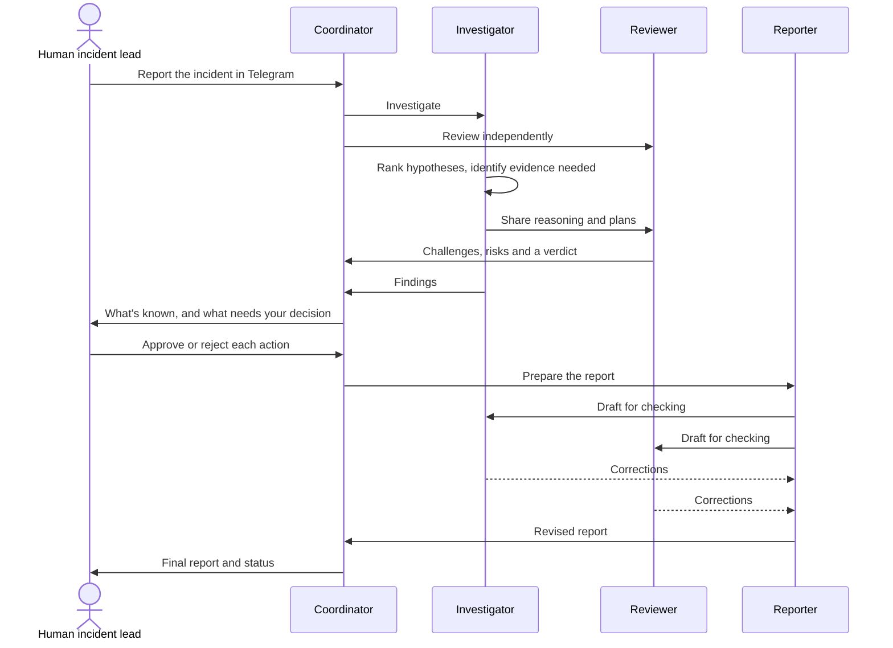

# SwitchOps

### The AI incident response team that argues with itself, then asks a human.

**[▶ Watch the demo](https://github.com/vaishalisen2002/switchops/releases/download/v1.0-demo/SwitchOps.mp4)** · **[📖 Read the story on Medium](https://medium.com/@senvaishali91/the-most-dangerous-thing-in-an-outage-is-a-convincing-wrong-answer-so-i-built-an-ai-team-on-switch-5a4be1ea52b4)** · [See it work](#the-test-a-payment-outage-with-no-easy-answer) · [Try it yourself](#try-it-yourself)

---

Payments are failing. A deployment went out twenty minutes ago. Within seconds, everyone has the same story: *the deploy broke it, roll it back.*

The story is tidy, and it might be wrong. The bank could be down. The rollback could collide with a schema change. Retrying those stuck payments could charge customers twice.

Ask a single AI assistant what went wrong and you'll get a fluent, confident answer, whether or not the evidence supports it. Nobody in that chat is there to disagree.

**SwitchOps puts someone in the room whose job is to disagree.** Four specialized AI agents work an incident together in one shared chat, keeping facts apart from guesses and challenging each other in the open. Nothing consequential happens until a human says so.

> [!NOTE]
> SwitchOps is a demonstration. Its test incident is simulated, and no production systems were accessed or changed.

## What makes it different

- **🔍 Guesses stay labelled as guesses.** Agents separate confirmed facts, hypotheses and recommendations.
- **⚔️ Every diagnosis gets challenged.** An independent Reviewer can accept a proposal, accept it with conditions, or reject it.
- **✋ Recommending never counts as approving.** A rollback plan can be ready to go and still not be authorized.
- **📂 A finished report doesn't close an incident.** It stays open until recovery and root cause are supported by evidence.

## Who it's for

- **On-call engineers and SREs** who want a second opinion at 3 a.m.
- **Incident commanders** who need to see what's known, what's assumed and what's waiting on them.
- **Small teams** without enough people to fill every incident role.
- **Teams in high-stakes domains** like payments, where a hasty fix can do more damage than the outage.

## Meet the team

| Agent | Its job | The rule it lives by |
|---|---|---|
| 🧭 `switchops-coordinator` | Leads triage, delegates work, consolidates findings, tracks decisions and maintains incident status | Keep the incident open until the evidence says otherwise |
| 🔬 `switchops-investigator` | Ranks technical hypotheses, identifies the evidence needed and proposes safe investigation or remediation plans | A hypothesis is not a root cause |
| ⚖️ `switchops-reviewer` | Challenges assumptions, checks risks, finds missing evidence and reviews proposed actions | Never agree by default |
| 📝 `switchops-reporter` | Produces the executive summary, timeline, findings, decisions, risks and follow-up actions | Record what was decided, and what wasn't approved |

And one more member, who outranks them all: **you, the human incident lead.**

## How it works

Here's one incident from start to finish:

## The test: a payment outage with no easy answer

I gave the team a simulated UPI payment gateway incident, **INC-DEMO-001**, with a deliberately thin brief: payments failing or stuck in pending, a deployment about 20 minutes ago, and no logs, metrics, deployment diff or provider status.

The timing points straight at the deployment, and nothing proves it. Here's how the team handled that trap.

**The Coordinator refused to treat the theory as fact:**

> **Assumption (not evidence):** the deploy caused it. The timing points that way, but it doesn't prove it.

**The Investigator ranked four hypotheses:** a deployment regression, a callback or webhook failure, connection-pool or infrastructure exhaustion, and an upstream PSP or bank issue. It also prepared a rollback-readiness plan.

**The Reviewer pushed back,** returning **ACCEPT WITH CONDITIONS**. Among its challenges:

- Deployment timing alone doesn't prove causation.
- Raising timeouts without understanding the exhaustion could make things worse.
- Callback signature verification must never be disabled as a shortcut.
- Payment retries must account for idempotency, or customers could be charged twice.

**The human drew the line.** Preparing a hypothetical rollback plan and a deployment-freeze recommendation was approved. Executing the rollback, changing configuration, retrying payments, replaying the DLQ, issuing refunds and contacting customers all stayed unapproved.

**And the team stayed honest about the ending:**

> **Resolved:** NO. There is no recovery evidence and no fix has been run. 
> **Root cause confirmed:** NO. 
> **Status:** OPEN

A lot of AI demos end with a confident answer. This one ends by saying what it doesn't know yet.

<table>
<tr>
<td></td>
<td></td>
</tr>
</table>

## Why Switch

[Switch](https://github.com/sandbox-quantum/switch) brings AI agents into the chat apps people already use, as named participants in a shared room. It's what turns four agents into one team:

| SwitchOps needs | Switch provides |
|---|---|
| One source of truth for the incident | Rooms that hold context, members and rules |
| Specialized agents | Named agents, each with its own role and working directory |
| A place for the human commander | A Telegram connection, so nobody learns a new tool mid-outage |
| Visible handoffs and disagreement | Mentions and a shared conversation |
| Limits on who can direct an agent | Owner-controlled access to each agent |
| A repeatable setup | YAML room and agent templates |

## The guardrails

These rules are written into the room and agent instructions:

- Separate confirmed facts from hypotheses and recommendations.
- Never fabricate logs, metrics, timestamps or evidence.
- Never claim a root cause is confirmed without supporting evidence.
- Require explicit human approval before consequential production actions.
- Treat approval to prepare a plan as separate from approval to execute it.
- Record approved, rejected and pending decisions separately.
- Treat rollbacks, retries, DLQ replay, refunds, configuration changes and customer communications as actions that may need separate approval.
- Label simulations clearly, and never describe simulated actions as completed production changes.

> [!IMPORTANT]
> These are workflow guardrails in agent instructions. They don't replace production access controls, monitoring or operational policy.

## Try it yourself

You'll need [Switch](https://docs.switchagents.ai/switch-rooms/getting-started), [Claude Code](https://claude.com/claude-code) and a Telegram bot and group.

1. **Install Switch Console.** Its assistant, switch-buddy, can help you with setup.
2. **Create the agents.** Start with the [Coordinator template](templates/switchops-coordinator.v2.template.yaml), then create the Investigator, Reviewer and Reporter using the roles above. Give each its own working directory.
3. **Allow delegation.** Set each agent's access to **Only me and my agents** so they can hand work to each other.
4. **Create the room.** Use the [room template](templates/switchops-room.template.yaml). The [exported Command Center configuration](templates/switchops-command-center.yaml) is there for reference.
5. **Connect Telegram,** following Switch's current documentation. Keep bot tokens and credentials private.
6. **Run a simulated incident.** Mention `switchops-coordinator`, label the incident as a simulation, and check that facts stay separate from hypotheses and nothing consequential happens without your approval.

Setup screens and options may vary by Switch version. This repository doesn't include credentials, bot tokens or local agent working directories.

## What's next

- [x] Record an end-to-end demo
- [x] Publish room and Coordinator templates
- [ ] Publish Investigator, Reviewer and Reporter templates
- [ ] Add reusable incident templates and severity criteria
- [ ] Add structured incident data and report versioning
- [ ] Add automated tests for approval boundaries and fact-versus-hypothesis handling
- [ ] Connect real logs, metrics and traces

## Contributing

Ideas and improvements are welcome. For substantial changes, please open an issue first. Please don't submit secrets, personal data, real customer information, production logs or unredacted incident details.

## License

SwitchOps is released under the [MIT License](LICENSE).

---

**AI shouldn't remove people from critical decisions. It should give them better information, stronger validation and a team that's ready to work.**

⭐ If this made you rethink AI in incident response, consider starring the repo.

